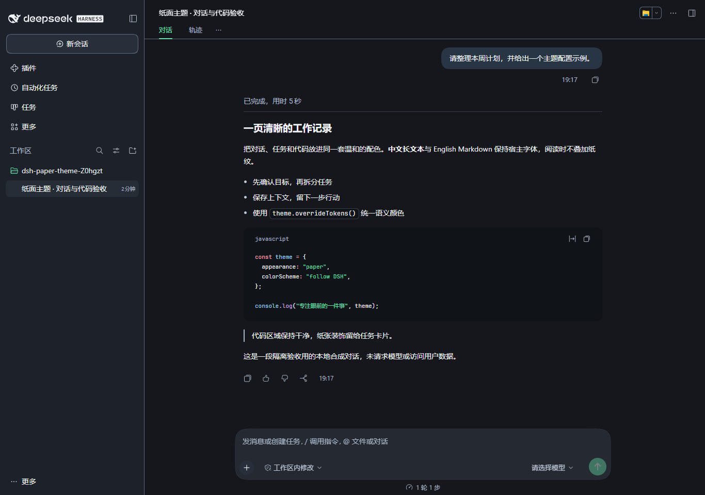

# dsh-plugin-paper-theme

独立、可选的 DSH 全局纸面主题。安装后保持宿主默认外观；在 **设置 → 全局主题 → 纸面主题** 中主动开启。0.1.2 使用纯白主画布、浅蓝底面与清晰的绿色交互色。任务页使用白色卡片、淡横线与黄／蓝／绿胶带；深色采用更暗的底板和更亮的卡纸，保留纸边、纤维与层叠感。正文、代码、工具栏和表单不铺粗纹理。

支持版本：**DSH 0.2.2-rc.1 Web renderer**，Node.js 24。桌面窗口外框不属于 Web renderer。其他版本需重新核验宿主接口与 token，不能据此声称兼容。

## 界面预览

以下为 0.1.2 在隔离 DSH 中的实际截图。

| 场景 | 浅色 | 深色 |
| --- | --- | --- |
| 对话与代码 |  |  |
| 任务看板 |  |  |

[全局主题设置](docs/screenshots/v0.1.2/02-paper-settings.png) · [窄屏任务浮层](docs/screenshots/v0.1.2/10-tasks-paper-narrow.png) · [完整验证记录与截图](docs/palette-refinement-0.1.2.md)

## 安装与更新

在此目录执行，无需构建：

```powershell
npm pack
dsh plugin --profile web add ./dsh-plugin-paper-theme-0.1.2.tgz
dsh --profile web
```

也可通过插件管理安装本地目录，或 `dsh plugin --profile web add <此目录的绝对路径>`。已运行的宿主更新插件后，应刷新浏览器以载入最新 Client。

本插件仅依赖 Host 配置 schema 包；浏览器通过 `require('react')` 复用宿主 React，不打包第二份 React。无构建、运行时 CDN、在线字体或源码下载。

## 开启、关闭与卸载

1. 打开 DSH 设置，进入独立的「全局主题」页，选择「纸面主题」。选项由宿主保存到当前 profile 的用户配置；刷新、重启和同宿主的其他页面均采用该选择。
2. 「通用」中的浅色、深色、跟随系统，以及字体与字号仍由 DSH 管理。这里的主题选择不会修改这些设置。
3. 选择「DSH 默认」立即撤销纸面 token 和全局标记。设置页本身使用局部样式，不改变宿主其他页面。
4. 在插件管理中禁用插件，撤销主题层、设置入口、设置样式和订阅。重新启用时恢复已保存的选择。
5. 在插件管理中卸载，本轮已验证当前页面立即清理主题层与设置入口。也可执行 `dsh plugin --profile web remove dsh-plugin-paper-theme`，然后按宿主提示刷新运行中的页面。保留的 profile 偏好不会在插件不存在时注入任何样式；若希望重新安装后仍默认关闭，先选择「DSH 默认」再卸载。

保存失败会显示错误，并保持最后确认的设置；保存期间禁止重复切换。设置来源不可用时撤销纸面层。只读连接可以显示宿主保存的主题，但不能修改。

## 与任务插件协作

两插件均可独立安装，无相互 npm 依赖。适配后的 `dsh-plugin-tasks` 默认沿用 DSH 外观，仅当 `body[data-dsh-paper-theme="paper"]` 存在时启用任务专属纸纹、胶带和高亮，并读取 `--dsh-paper-*` 变量。关闭主题无需重新挂载任务面板；草稿、搜索、选择列表和实时连接不因外观切换而重建。任务页没有独立外观开关。

## 工程与验证

- [宿主接口、token 与生命周期](docs/host-adapter.md)
- [来源与许可证记录](docs/sources.md)
- [0.1.2 明亮配色与纸张层次](docs/palette-refinement-0.1.2.md)
- [0.1.1 配色调整历史记录](docs/palette-refinement-0.1.1.md)
- [0.1.0 首轮完整验证记录](docs/verification.md)

`npm install && npm test` 运行状态与生命周期测试。真实浏览器验收使用 `scripts/verify-browser.mjs` 与 `scripts/browser-harness.mjs` 创建独立临时 DSH home，不使用日常 home 的任务、会话和配置。复现命令见验证报告；开发脚本和测试不进入安装包。
