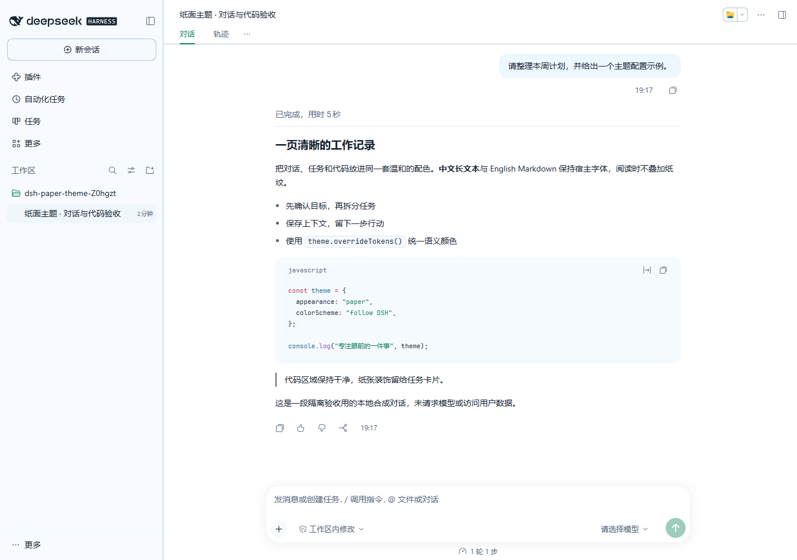
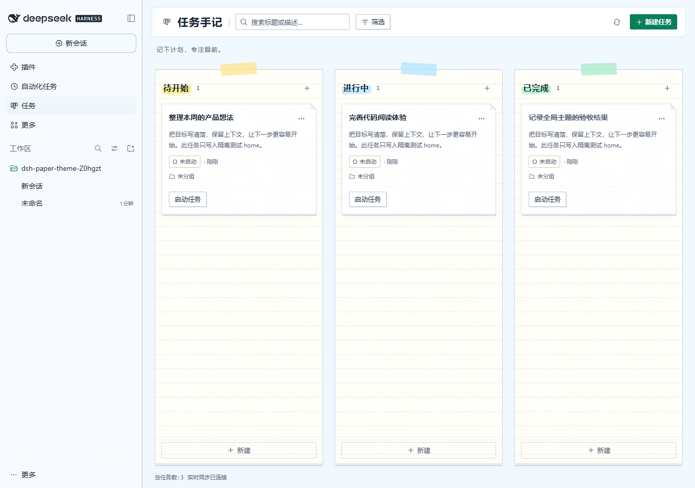
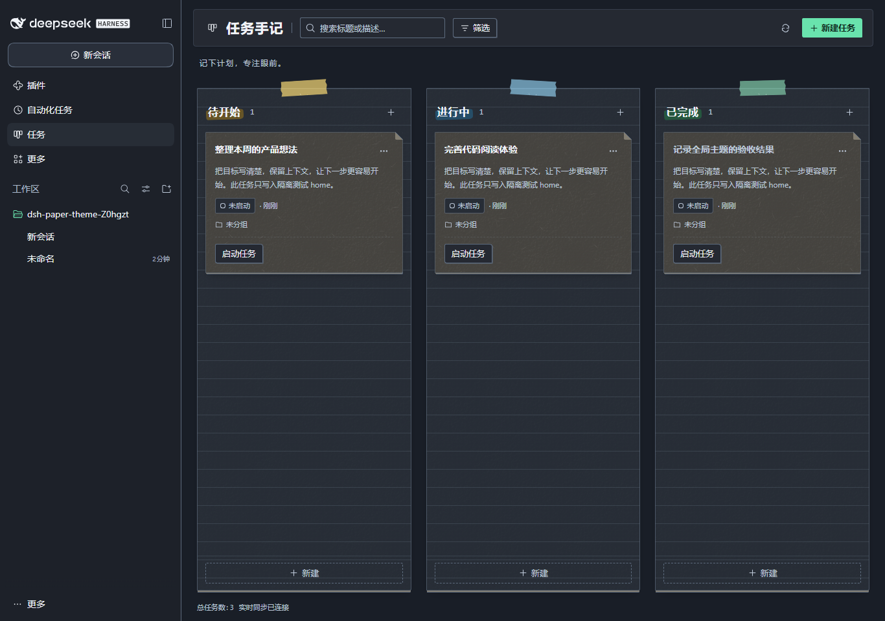

# Tavlo 纸面主题（`@tavlo-dsh/dsh-plugin-paper-theme`）

独立、可选的 DSH 外观插件。安装后默认保持宿主外观，在 **设置 → 全局主题** 中选择：

- **iOS 圆角**：浅色使用白色主背景、淡蓝侧栏、简洁圆角和轻阴影；深色采用中性炭灰。对话、控件和任务看板共用同一套配色与圆角。
- **纸面主题**：圆角纸张、任务卡和控件，保留绿色强调、纸纹、横线和胶带。
- **DSH 默认**：恢复宿主原有外观。

支持版本：**DSH 0.2.2-rc.1 Web renderer**，Node.js 24。桌面窗口外框不属于 Web renderer。其他版本需重新核验宿主接口与 token，不能据此声称兼容。

## 界面预览

以下为原纸面主题在隔离 DSH 中的实际截图。

| 场景 | 浅色 | 深色 |
| --- | --- | --- |
| 对话与代码 |  |  |
| 任务看板 |  |  |

[全局主题设置](docs/screenshots/v0.1.2/02-paper-settings.png) · [窄屏任务浮层](docs/screenshots/v0.1.2/10-tasks-paper-narrow.png) · [完整验证记录与截图](docs/palette-refinement-0.1.2.md)

## 安装与更新

在 DSH 的插件管理中按包名安装 `@tavlo-dsh/dsh-plugin-paper-theme`，或使用 CLI：

```powershell
dsh plugin --profile web add @tavlo-dsh/dsh-plugin-paper-theme
```

如已安装未加 scope 的本地旧包，先卸载旧包再安装新包，避免两个主题插件同时启用。`web` 请替换为实际使用的 profile。

从源码安装无需构建，在此目录执行：

```powershell
npm pack
dsh plugin --profile web add ./tavlo-dsh-dsh-plugin-paper-theme-0.1.2.tgz
```

也可通过插件管理安装本地目录，或 `dsh plugin --profile web add <此目录的绝对路径>`。更新后，若正在运行的 Host 仍使用旧的 Client 入口，需重启 Host 并刷新页面。

本插件仅依赖 Host 配置 schema 包；浏览器通过 `require('react')` 复用宿主 React，不打包第二份 React。无构建、运行时 CDN、在线字体或源码下载。

## 开启、关闭与卸载

1. 打开 DSH 设置，进入「全局主题」页，选择「iOS 圆角」或「纸面主题」。选项由宿主保存到当前 profile；刷新、重启和同宿主的其他页面均采用该选择。
2. 「通用」中的浅色、深色、跟随系统，以及字体与字号仍由 DSH 管理。这里的主题选择不会修改这些设置。
3. 选择「DSH 默认」撤销全局主题覆盖。若任务看板设置了独立外观，它不受这一步影响；看板切回「跟随全局」即可一并恢复默认。
4. 在插件管理中禁用插件，撤销主题层、设置入口、设置样式和订阅。重新启用时恢复已保存的选择。
5. 在插件管理中卸载，或执行 `dsh plugin --profile web remove @tavlo-dsh/dsh-plugin-paper-theme`。插件不存在时，已保存的偏好不会应用；若希望重新安装后仍默认关闭，先将全局选为「DSH 默认」、看板选为「跟随全局」。

切换立即预览，偏好在后台保存；连续切换时，尚未发送的选择只保留最后一次。保存失败会提示并恢复宿主最后确认的外观。设置来源不可用时撤销主题层。只读连接可以显示宿主保存的主题，但不能修改。

## 与任务插件协作

两插件均可独立安装，无相互 npm 依赖。更新两个插件后，任务工具栏会显示「任务卡片外观」：默认「跟随全局」，也可单独选「iOS 圆角」或「纸面主题」，只刷新看板样式，不重算全局主题。这是整个看板的外观偏好，不会改变单张任务的数据。切换不会重建任务面板，草稿、搜索、选择列表和实时连接都会保留。没有主题插件时，任务继续使用 DSH 默认外观。

iOS 和纸面外观共用紧凑工具栏，按看板可用宽度自动换行；纸面保留「任务手记」标题与绿色新建按钮。

## 工程与验证

- [宿主接口、token 与生命周期](docs/host-adapter.md)
- [来源与许可证记录](docs/sources.md)
- [0.1.2 明亮配色与纸张层次](docs/palette-refinement-0.1.2.md)
- [0.1.1 配色调整历史记录](docs/palette-refinement-0.1.1.md)
- [0.1.0 首轮完整验证记录](docs/verification.md)

`npm install && npm test` 运行状态与生命周期测试。真实浏览器验收使用 `scripts/verify-browser.mjs` 与 `scripts/browser-harness.mjs` 创建独立临时 DSH home，不使用日常 home 的任务、会话和配置。复现命令见验证报告；开发脚本和测试不进入安装包。
